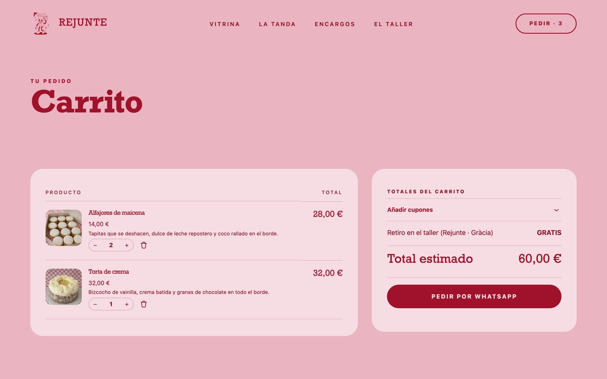

<div align="center">

# Rejunte

**A WordPress block theme for an Argentine bakery in Barcelona.**
A Vue prototype rebuilt pixel for pixel as Gutenberg blocks, with a WooCommerce store whose orders close on WhatsApp.


</div>

## Highlights

- **Pixel-perfect port.** Every section of the Vue prototype is a Gutenberg block. Playwright compares the two pages pixel by pixel: same height, 0.7% of pixels different, all of them inside photographs (WebP vs AVIF encoding).
- **The editor is the site.** Blocks are edited in place, text where it appears and images on the image. Pages and products open with their template around them. The editor canvas and the live page differ by under 0.7% of pixels.
- **Orders by WhatsApp.** "Sumar" adds to the real WooCommerce cart. The cart's **Pedir por WhatsApp** button opens WhatsApp with the order already written. The message is built on the server from the cart and updates with every change of quantity. The number lives in the Customizer.
- **Fast by construction.** All CSS is inlined, about 9 KB of deferred ES modules in total, no jQuery outside the store pages, WebP images with correct `sizes` and only the hero eager. Lighthouse desktop scores 100 in all four categories.
- **Accessible.** axe finds zero WCAG 2.2 AA violations on every theme page. There is a real skip link, a control that pauses every animation, full keyboard support for the gallery and menu, and reduced-motion handling throughout.
- **Readable by search engines and AI assistants.** One linked JSON-LD graph per page (Bakery, Product, Offer, BreadcrumbList, ItemList), generated from the same text visitors read. `/llms.txt` gives assistants a Markdown summary of the bakery and its products.

## Screenshots

### Editing looks like the site


The front page in the block editor. Headings and buttons are edited where they sit, images change from controls on the image itself, and the sidebar holds only what has no place on the page, such as alt text.

### La vitrina


A bento grid. Every tile is its own block, so tiles can be reordered, resized (1×1, 2×1, 2×2) or swapped between photo, word and highlight. With a mouse, tiles respond to the cursor with a spotlight, tilt and a border glow.

### On a phone


Front page, the curved "La tanda" gallery (drag, arrow keys or buttons), a product page, and the menu.

### The store, in the same visual language




The cart button opens WhatsApp with:

```
¡Hola Rejunte! Quiero hacer este pedido:

• 2 × Alfajores de maicena (Docena) — 28 €
• 1 × Torta de crema (18 cm · 10 porciones) — 32 €

Total: 60 €

¿Cuándo lo puedo pasar a buscar?
```

### Prototype vs WordPress


The Vue prototype (left), the WordPress theme (centre) and their difference (right): only the logo's edge pixels differ, from image encoding.

<details>
<summary>The whole front page</summary>


</details>

## Tech stack

| | |
| --- | --- |
| **Platform** | WordPress 7.1 block theme: Full Site Editing, `theme.json` v3, templates, template parts, patterns |
| **Blocks** | 12 custom blocks with React `edit`/`save` (apiVersion 3); dynamic `render.php` for the store blocks; `block.json` metadata with per-block assets |
| **Store** | WooCommerce 11: Store API with a custom `extensions` payload, WooCommerce Blocks checkout filters, local pickup |
| **Styles** | SCSS (Dart Sass), design tokens from `theme.json` presets, BEM classes, logical properties, container queries |
| **Front-end JS** | Vanilla ES modules via `viewScriptModule`, loaded only where their block is: gallery engine, bento effects, menu, cart. No frameworks or jQuery. |
| **Build** | `@wordpress/scripts` (webpack), blocks manifest, `wp i18n` POT |
| **Images** | WebP originals and sub-sizes, responsive `srcset`/`sizes`, palette PNG brand marks, a dedicated LCP image |
| **SEO / GEO** | JSON-LD `@graph`, Open Graph, canonicals, sitemap, `/llms.txt`, business data parsed from visible content |
| **Quality** | Playwright (pixel diffs, editor parity, user flows, overflow scans in Chromium, WebKit and Firefox), axe-core, Lighthouse |
| **Language** | Spanish (es_ES); every string translatable through the `rejunte` text domain |

## How it's built

```
inc/           PHP, one concern per file: setup, assets, blocks, performance, accessibility,
               business data, contact (Customizer), SEO, llms.txt, WooCommerce
src/blocks/    one folder per block: block.json, edit.js, save.js or render.php, view.js, style.scss
src/shared/    image slot, editor controls, gallery and bento engines, cart store, order buttons
src/scss/      tokens, reset, shared components, layout, prose, editor, WooCommerce
templates/     front page, pages, posts, 404, and the WooCommerce templates
parts/         header and footer
patterns/      ticker and 404
```

| Block | What it is |
| --- | --- |
| Cabecera | Brand, menu with the current page marked, live "Pedir · N" order button, phone menu |
| Portada | Hero with the LCP image (`fetchpriority="high"`) |
| La tanda | Curved drag gallery, rendered at rest by HTML/CSS; JavaScript only adds motion |
| Cinta | Decorative marquee: hidden from screen readers, pausable |
| La vitrina + Mosaico | Bento grid with cursor effects |
| Precios + Tarjeta de precio | Cards that can link to a product for its live price and add-to-cart |
| Encargos | Custom-order panel on a checkered background |
| Pie | Footer whose address, hours and phone feed the structured data |
| Producto, Productos | Product page header and product grids (server-rendered) |

Full developer documentation: [docs/DEVELOPMENT.md](docs/DEVELOPMENT.md).

## How it was verified

| Check | Result |
| --- | --- |
| Prototype vs WordPress (Playwright, 1440px and 390px) | Identical page height; 0.72% / 1.22% of pixels differ, all inside photos |
| Block editor vs live page (front page, menu pages, a product) | 0.18–0.63% of pixels differ |
| Accessibility (axe-core, WCAG 2.2 AA + best practices, desktop and phone) | 0 violations on theme pages |
| Lighthouse desktop (home, product, shop) | 100 / 100 / 100 / 100 |
| Lighthouse mobile, local server with no compression | 87–98 performance, 100 the rest |
| Responsive scan: 12 page types × 10 widths × 3 browser engines | No sideways scroll from 360px up; the remaining issues are in the backlog |
| User flows | Add to order, cart, WhatsApp message, products with options |

The scripts are in [`tests/visual/`](tests/visual/).

## Run it locally

Requirements: WordPress 6.8+, PHP 8.1+, WooCommerce 9+ (optional) and Node 20+.

```sh
cd wp-content/themes
git clone git@github.com:TommoParra/Rejunte.git rejunte
cd rejunte
npm install
npm run build    # or: npm run start, to watch
```

Activate **Rejunte** under Appearance → Themes. The WhatsApp number and order message are under Appearance → Customize → **Datos de contacto**.

## Roadmap

The road to launch is tracked in [backlog.md](backlog.md): legal pages and cookie consent, allergen information, a few responsive fixes, production server and migration steps, and UX polish such as a pickup-day choice for WhatsApp orders.

## Credits

Design from the Rejunte prototype. Brand, illustrations and photographs belong to Rejunte and are not covered by the code license. Theme code is licensed GPL-2.0-or-later, like WordPress.
