<div align="center">

# Rejunte

**A WordPress block theme for an Argentine bakery in Barcelona.**
A Vue prototype rebuilt pixel for pixel as Gutenberg blocks, with a WooCommerce store whose orders close on WhatsApp.


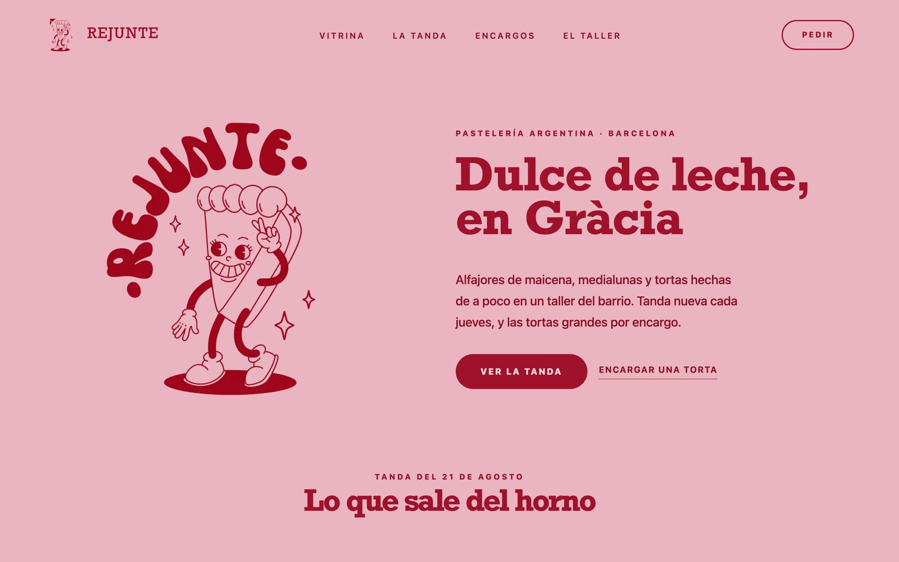

</div>

## Highlights

- **Pixel-perfect port.** Every section of the Vue prototype is a Gutenberg block. Playwright compares the two pages pixel by pixel. Under 1% of pixels differ on desktop, and the differences are photo encoding, the automatic batch date and the footer's added legal row.
- **The editor is the site.** Blocks are edited in place: text where it appears and images on the image. Pages and products open with their template around them. The editor canvas and the live page differ by under 0.6% of pixels.
- **Orders by WhatsApp.**
  - "Sumar" adds to the real WooCommerce cart and confirms with a small toast.
  - In the cart, the customer picks a pickup day, and **Pedir por WhatsApp** opens WhatsApp with the whole order already written.
  - The message is built on the server from the cart and updates with every change.
  - The number lives in the Customizer.
- **Fast by construction.**
  - All CSS is inlined.
  - About 11 KB of deferred ES modules, loaded only where their block is, plus a 5 KB consent script.
  - No jQuery outside the store pages.
  - WebP images with correct `sizes`; only the hero loads eagerly.
  - Lighthouse desktop scores 100 in all four categories.
- **Accessible.**
  - axe finds zero WCAG 2.2 AA violations on every theme page, with the cookie notice open too.
  - A real skip link and a control that pauses every animation.
  - Full keyboard support for the gallery and the menu.
  - Reduced-motion handling throughout.
- **Readable by search engines and AI assistants.**
  - One linked JSON-LD graph per page: Bakery, Product with Offer and merchant-listing fields, BreadcrumbList, ItemList and FAQPage. It is generated from the same text visitors read.
  - `/llms.txt` gives assistants a Markdown summary of the bakery, its products and its FAQ.
- **Ready for EU rules.**
  - A first-party cookie notice that becomes a full consent banner as soon as an analytics service is configured.
  - Spanish legal pages built from block patterns.
  - Ingredient and allergen fields for every product (Reg. UE 1169/2011).

## Screenshots

### Editing looks like the site

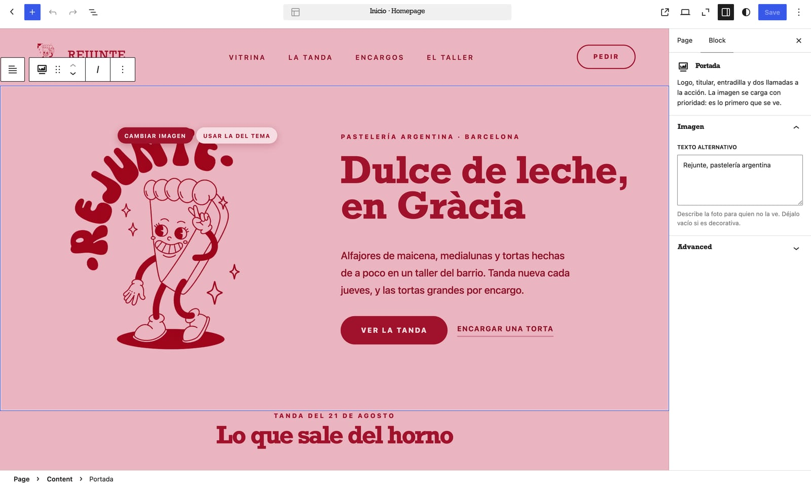

The front page in the block editor. Headings and buttons are edited where they sit, and images change from controls on the image itself. The sidebar holds only what has no place on the page, such as alt text.

### La vitrina

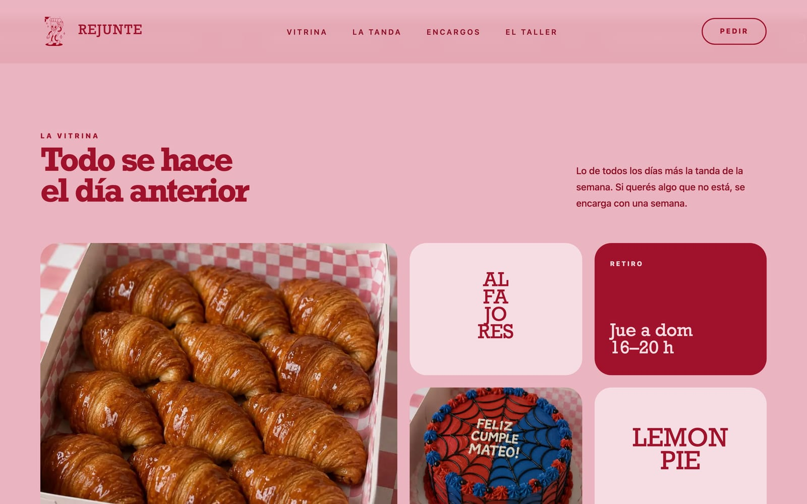

A bento grid. Every tile is its own block, so tiles can be:

- reordered;
- resized (1×1, 2×1, 2×2);
- switched between photo, word and highlight.

With a mouse, tiles respond to the cursor with a spotlight, a tilt and a border glow.

### On a phone

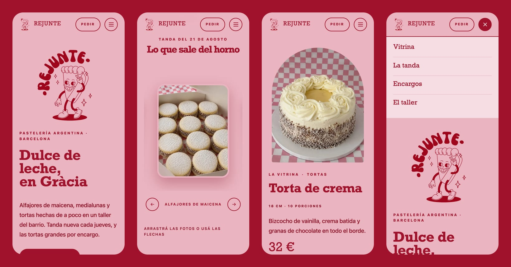

The front page, the curved "La tanda" gallery (drag, arrow keys or buttons), a product page and the menu.

### The store, in the same visual language

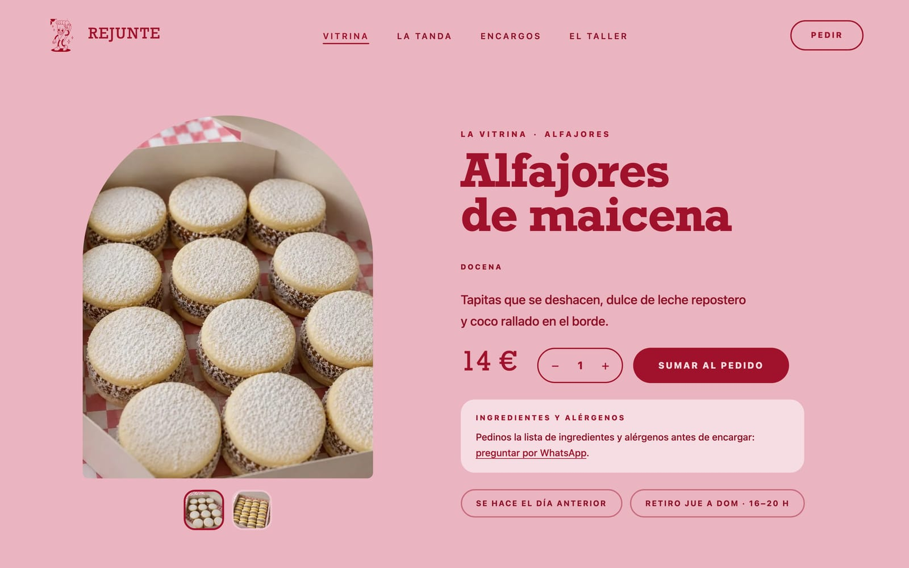

Product pages show ingredients and allergens next to the add button. Until a product's data is filled in, the box offers to ask by WhatsApp instead.

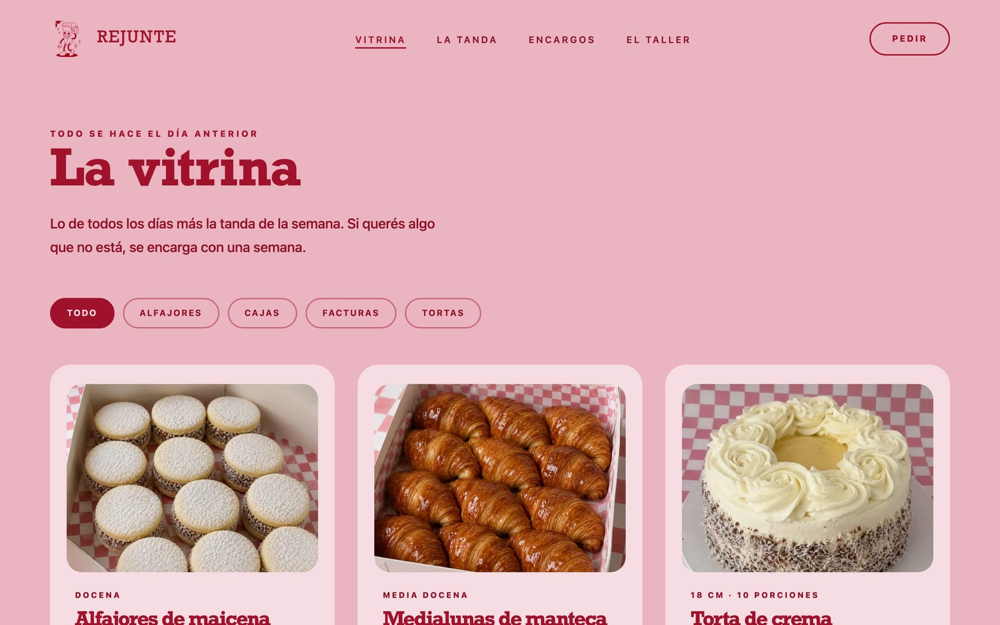

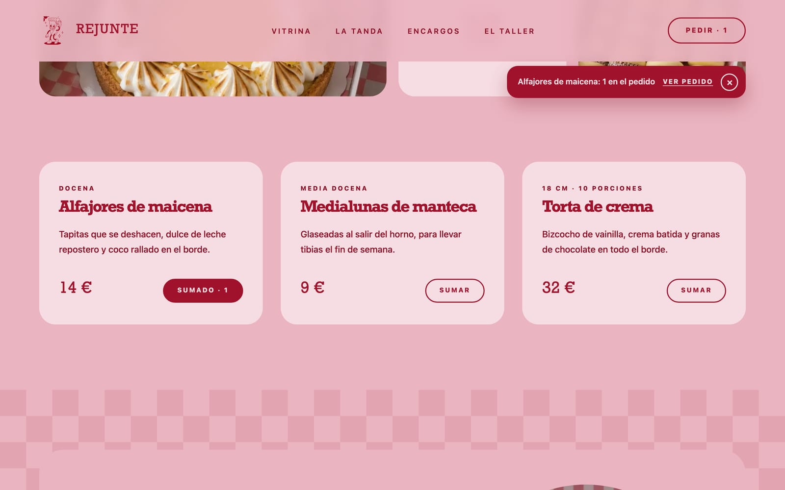

Adding to the order: the button counts, the header counts, and a polite toast links to the order.


The cart button opens WhatsApp with:

```
¡Hola Rejunte! Quiero hacer este pedido:

• 2 × Alfajores de maicena (Docena) — 28 €
• 1 × Torta de crema (18 cm · 10 porciones) — 32 €

Retiro: domingo 4 de octubre, de 16:00 a 20:00
Total: 60 €

¿Me lo confirmás?
```

On a computer without WhatsApp, "¿No tenés WhatsApp? Copiá el pedido" copies the same text and shows the phone number.

### Cookies, legal pages and FAQ

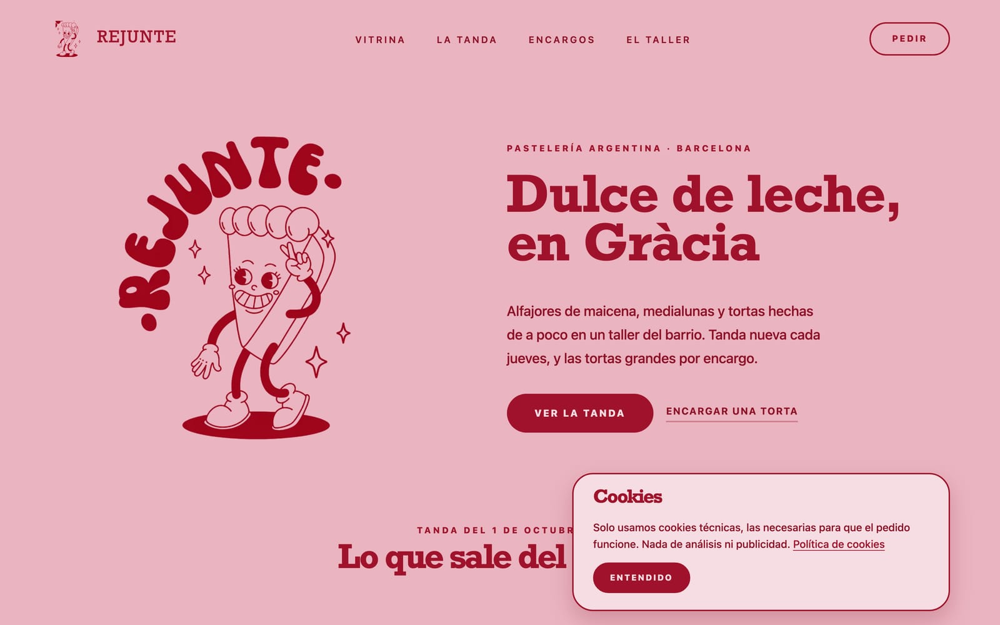

While the site only uses technical cookies, a short notice is enough. When an analytics ID is added in the Customizer, it becomes a banner with Aceptar, Rechazar and Configurar, each with the same weight. Nothing optional loads before consent. The choice can be changed from the footer.

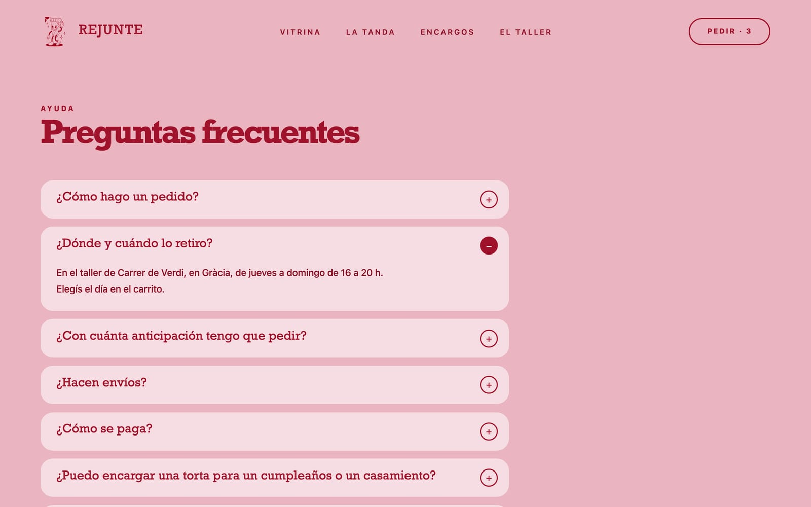

The FAQ block uses native disclosure widgets. Its questions also feed the `FAQPage` structured data and `/llms.txt`.

### Prototype vs WordPress

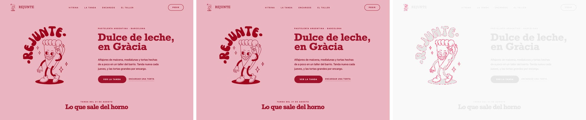

The Vue prototype (left), the WordPress theme (centre) and their difference (right). Only the logo's edge pixels differ, from image encoding.

<details>
<summary>The whole front page</summary>

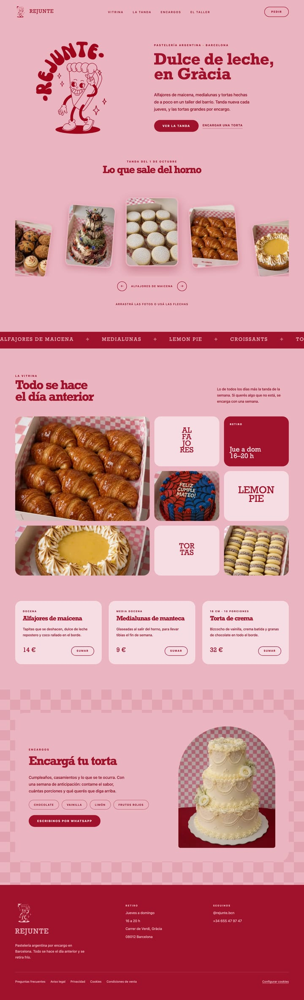

</details>

## Tech stack

| | |
| --- | --- |
| **Platform** | WordPress 7.1 block theme: Full Site Editing, `theme.json` v3, templates, template parts, patterns |
| **Blocks** | 13 custom blocks with React `edit`/`save` (apiVersion 3); dynamic `render.php` for the store blocks; `block.json` metadata with per-block assets |
| **Store** | WooCommerce 11: Store API with a custom `extensions` payload and update callback, WooCommerce Blocks checkout filters and slot fills, local pickup |
| **Styles** | SCSS (Dart Sass), design tokens from `theme.json` presets, BEM classes, logical properties, container queries |
| **Front-end JS** | Vanilla ES modules via `viewScriptModule`, loaded only where their block is: gallery engine, bento effects, menu, cart. No frameworks or jQuery. |
| **Fonts** | The prototype's stacks (Rockwell, system UI) with a self-hosted Arvo WOFF2 fallback (Latin subset), so Windows and Android keep the slab-serif look |
| **Build** | `@wordpress/scripts` (webpack), blocks manifest, `wp i18n` POT, `npm run zip` for a clean distributable |
| **Images** | WebP originals and sub-sizes, responsive `srcset`/`sizes`, palette PNG brand marks, a dedicated LCP image |
| **SEO / GEO** | JSON-LD `@graph`, Open Graph, canonicals, sitemap without `noindex` pages, `/llms.txt`, business data parsed from visible content |
| **Privacy** | First-party consent manager with a JS API (`rejunteConsent.on('analytics', …)`), cookie inventory, legal page patterns |
| **Quality** | Playwright (pixel diffs, editor parity, user flows, overflow scans in Chromium, WebKit and Firefox), axe-core, Lighthouse |
| **Language** | Spanish (es_ES); every string translatable through the `rejunte` text domain |

## How it's built

```
inc/           PHP, one concern per file: setup, assets, blocks, performance, hardening,
               accessibility, business data, contact (Customizer), consent, SEO, llms.txt,
               WooCommerce
src/blocks/    one folder per block: block.json, edit.js, save.js or render.php, view.js, style.scss
src/shared/    image slot, editor controls, gallery and bento engines, cart store, order buttons
src/scss/      fonts, tokens, reset, shared components, layout, prose, editor, WooCommerce
assets/        compiled CSS, consent and cart scripts, fonts, brand images
templates/     front page, pages, posts, 404, search, and the WooCommerce templates
parts/         header and footer
patterns/      ticker, 404, FAQ, and the four legal pages
tests/visual/  Playwright, axe and SEO checks (npm run test:*)
docs/          development guide, deployment guide, screenshots
```

| Block | What it is |
| --- | --- |
| Cabecera | Brand, menu with the current page marked, live "Pedir · N" order button, phone menu |
| Portada | Hero with the LCP image (`fetchpriority="high"`) |
| La tanda | Curved drag gallery, rendered at rest by HTML/CSS; JavaScript only adds motion. Its date can update itself every week. |
| Cinta | Decorative marquee: hidden from screen readers, pausable |
| La vitrina + Mosaico | Bento grid with cursor effects |
| Precios + Tarjeta de precio | Cards that can link to a product for its live price and add-to-cart |
| Encargos | Custom-order panel on a checkered background |
| Preguntas frecuentes | Accessible Q&A that feeds `FAQPage` and `/llms.txt` |
| Pie | Footer whose address, hours and phone feed the structured data, with the legal links and "Configurar cookies" |
| Producto, Productos | Product page header (with ingredients and allergens) and product grids, server-rendered |

More detail:

- [docs/DEVELOPMENT.md](docs/DEVELOPMENT.md) — the development guide;
- [docs/DEPLOYMENT.md](docs/DEPLOYMENT.md) — going live.

## How it was verified

| Check | Result |
| --- | --- |
| Prototype vs WordPress (Playwright, 1440px and 390px) | 0.77% / 1.28% of pixels differ: photo encoding, the automatic date, the footer legal row |
| Block editor vs live page (front page, a product) | 0.57% / 0.35% of pixels differ |
| Accessibility (axe-core, WCAG 2.2 AA + best practices, desktop and phone) | 0 violations on theme pages, cookie notice included |
| Lighthouse desktop (home, product, shop, a legal page) | 100 / 100 / 100 / 100 |
| Lighthouse mobile, local server with no compression | Performance 95–100; the other three categories 100; CLS 0 |
| Responsive scan: 14 page types × 10 widths (320–2560px), plus WebKit and Firefox | No sideways scroll anywhere |
| User flows | Add to order and the toast, products with options, cart, pickup day, the WhatsApp message, the cookie notice |
| Cookies | None on first visit, no third-party requests; only WooCommerce's strictly necessary cart cookies after adding to the cart |

```sh
npm run test:visual     # accessibility, responsive, flows and SEO; or one at a time:
npm run test:prototype  # pixel diff against the prototype (PROTOTYPE_URL)
npm run test:editor     # editor canvas vs live page (needs WP-CLI)
npm run test:flows      # ordering flows and the WhatsApp message
npm run test:a11y       # axe
npm run test:responsive # overflow scan, Chromium
npm run test:browsers   # overflow scan, WebKit and Firefox
npm run test:seo        # titles, canonicals, JSON-LD, sitemap
```

The scripts are in [`tests/visual/`](tests/visual/). They read the site from `REJUNTE_URL`.

## Run it locally

Requirements:

- WordPress 6.8+;
- PHP 8.1+;
- WooCommerce 9+ (optional);
- Node 20+.

```sh
cd wp-content/themes
git clone git@github.com:TommoParra/Rejunte.git rejunte
cd rejunte
npm install
npm run build    # or: npm run start, to watch
npm run zip      # rejunte.zip, without development files
```

Activate **Rejunte** under Appearance → Themes. Under Appearance → Customize:

- **Datos de contacto** holds the WhatsApp number and the order message;
- **Privacidad y cookies** holds an optional GA4 ID.

## Roadmap

The theme work is done. What's left before launch is listed in [backlog.md](backlog.md):

- the business's legal details for the draft legal pages;
- ingredients and allergens for each product;
- Google Business Profile;
- the production server and the migration.

## Credits

Design from the Rejunte prototype. Brand, illustrations and photographs belong to Rejunte and are not covered by the code license. Theme code is licensed GPL-2.0-or-later, like WordPress. Arvo is by Anton Koovit, under the SIL Open Font License (`assets/fonts/OFL-Arvo.txt`).
